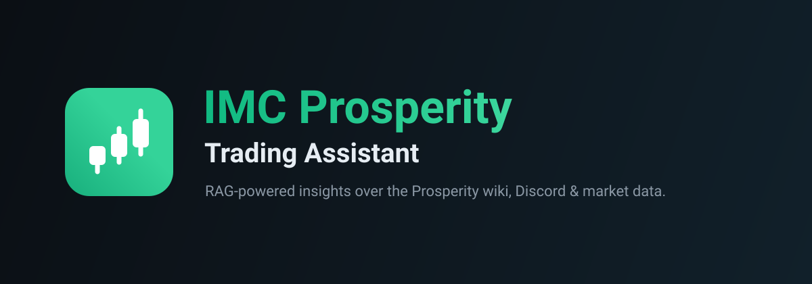
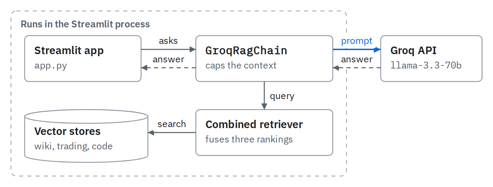

<p align="center">
  <picture>
    <source media="(prefers-color-scheme: dark)" srcset="assets/banner-dark.svg">
    <source media="(prefers-color-scheme: light)" srcset="assets/banner-light.svg">
    
  </picture>
</p>

[](https://github.com/Builder106/imc-prosperity/actions/workflows/ci.yml)
[](https://www.python.org/)
[](#license)
[](https://tradetell.streamlit.app)
[](https://streamlit.io)

> **A workbench for IMC Prosperity research.** Inspect recorded markets, replay a built-in Trader, and ask questions grounded in competition sources.

## What is TradeTell?

TradeTell brings three tasks into one Streamlit page. The Market desk lets you explore a recorded Round 2 price trace, order book, and public trades. The Replay lab runs a built-in strategy on a small, matching historical sample. Ask TradeTell searches competition rules, market data, and code examples to answer questions with inspectable sources.

The market and replay views work without an API key. The assistant needs a Groq API key and builds its search index when you first ask a question.

**Live app:** [tradetell.streamlit.app](https://tradetell.streamlit.app)

## Technical overview

The market viewer reads a tracked Round 2 fixture. The Replay lab uses matching Round 1 and Round 2 samples with the existing simulator's fill rules. The research view searches the local wiki, market, and code corpora to:

- Answer questions about IMC Prosperity rules, mechanics, and market concepts
- Draft Trader classes for review and testing
- Show the retrieved material behind each answer

## Features

- **Market desk**: Product and time controls for a tracked Round 2 price fixture, with a linked order-book snapshot and public-trade tape
- **Replay lab**: Built-in Round 1 and Round 2 Traders, three public-trade matching rules, and sample P&L, drawdown, fill, and rejection results
- **Ask TradeTell**: Conversational research with chat history, retrieved source documents, and example prompts
- **Multi-source search**: Searches across three in-process knowledge stores (rules wiki, historical trading data, and code examples)
- **Groq inference**: Uses `llama-3.3-70b-versatile` by default when answering questions
- **Trading log analyzer**: A separate command summarizes competition logs

## How it works



Streamlit sends the question to GroqRagChain. Its combined retriever searches local wiki, trading, and code stores and returns weighted context. Groq generates the answer, which Streamlit shows with the source documents. [Editable HTML source](assets/diagrams/rag-flow.html).

The vector stores are built in memory when the first question is asked. Streamlit
caches the assembled retriever, but the first question still processes and embeds
the corpus.

## Project structure

- **`app.py`**: Streamlit workbench entry point (market, replay, and research views)
- **`src/`**: source code
  - **`rag/`**: RAG system
    - **`build_rag_system.py`**: document processing, vector stores, retriever, chain
    - **`groq_llm.py`**: `GroqRagChain` (Groq-backed, swappable backend)
    - **`model_config.py`**: env-driven model/embedding configuration
    - **`process_raw_trading_data.py`**: trading-data processing
  - **`algorithms/`**: round-by-round trading algorithms
  - **`utils/`**: Notion scraper and trading-log tools
- **`data/`**: `prosperity_wiki/` (Markdown), `trading_data/`, and tracked `samples/` for the Replay lab
- **`tests/`**: pytest suite (offline; network mocked)

## Getting started

### Prerequisites

- Python 3.11+
- Installed dependencies (`uv sync --group dev`)
- A Groq API key for Ask TradeTell ([console.groq.com/keys](https://console.groq.com/keys))

### Installation

```bash
git clone https://github.com/Builder106/imc-prosperity.git
cd imc-prosperity
uv sync --group dev
```

To use Ask TradeTell, create a `.env` in the project root with your Groq API key:

```bash
GROQ_API_KEY=your_groq_api_key_here
```

Optional overrides (defaults shown):

```bash
LLM_MODEL=llama-3.3-70b-versatile
LLM_TEMPERATURE=0.2
GROQ_TIMEOUT_SECONDS=180
EMBEDDING_MODEL=sentence-transformers/all-MiniLM-L6-v2
```

When deploying on Streamlit Community Cloud, add the same keys under
**Manage app → Settings → Secrets** instead of a `.env` file.

### Running

```bash
streamlit run app.py
```

## Usage

1. Open **Market desk** and choose a product, time window, and timestamp to inspect recorded prices, quotes, and public trades.
2. Open **Replay lab**, choose a built-in Trader and matching rule, and run its 800-tick sample. Expand the fill assumptions before interpreting its P&L.
3. Open **Ask TradeTell** to ask about rules or strategies. Expand **Sources** under an answer to inspect the retrieved context.

### Working with trading logs

```bash
python src/utils/summarize_trading_logs.py
```

Follow the prompts to input a log file path and receive a detailed summary.

### Evaluating strategies

Replay a built-in strategy on a local historical archive:

```bash
uv run python -m src.evaluation.strategy_replay --round 1 --match-trades worse
```

Use `--round 2` or pass `--day -1` to select one day. The report includes
daily P&L, drawdown, fills, inventory, and rejected orders. Queue priority,
conversions, and Round 2 market-access bidding are not modeled. See the
[evaluation plan](docs/specs/rag-eval-and-decoupling-plan.md) for the fill rules.
Rows with no quotes carry forward the last valid mid price for inventory
valuation. The Streamlit Replay lab uses tracked 800-tick samples; the CLI can
read the larger local archive when it is available.

Measure retrieval against the app's local corpus and embedding model:

```bash
uv run python -m src.rag.retrieval_evaluation --k 5
```

This reports source recall at k and mean reciprocal rank without calling the
Groq API. The first run may download the configured Hugging Face model.
Add `--compare-corpora` to score the wiki, trading, and code stores separately
from the combined retriever.

## Development

See [CONTRIBUTING.md](CONTRIBUTING.md) for setup, test commands, and project
guardrails. Run the suite with:

```bash
pytest
```

The deterministic unit coverage gate is:

```bash
uv run pytest --cov-report=term-missing
```

## Acknowledgments

- IMC Prosperity for the trading competition
- LangChain for the RAG framework
- Groq for fast LLM inference
- Streamlit for the web interface

## License

Released under the [MIT License](LICENSE).
